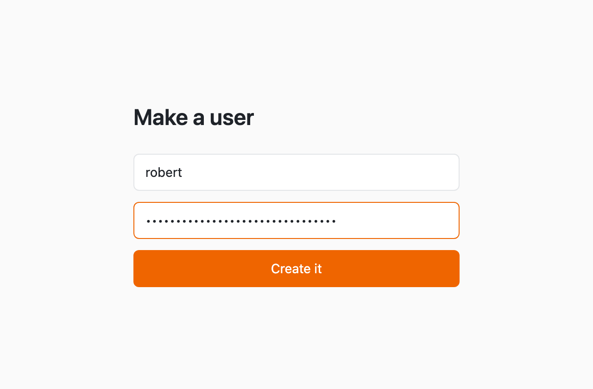
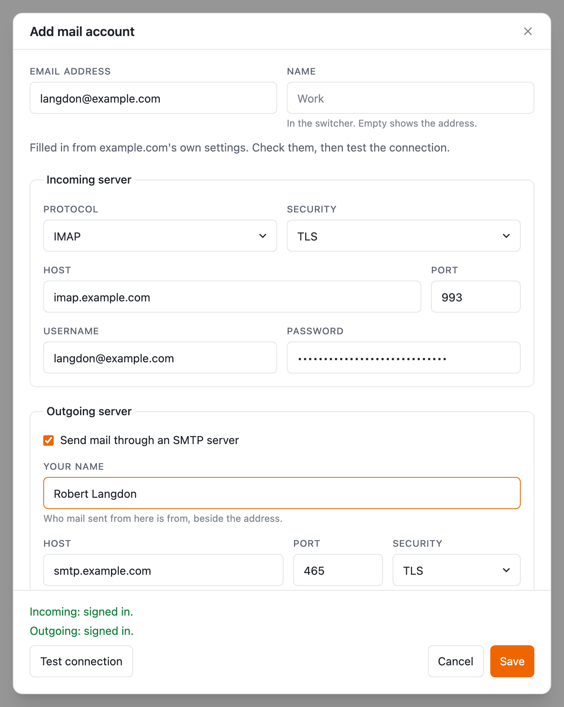
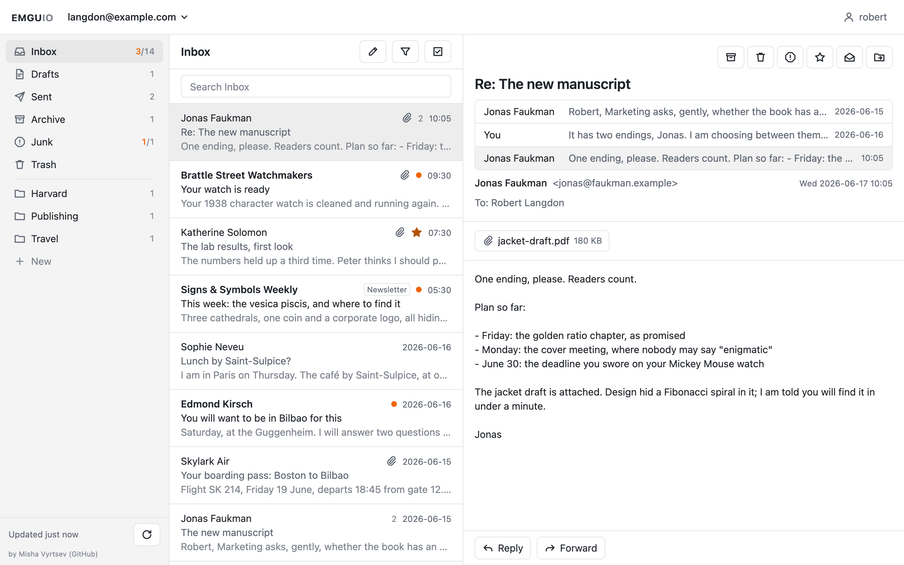
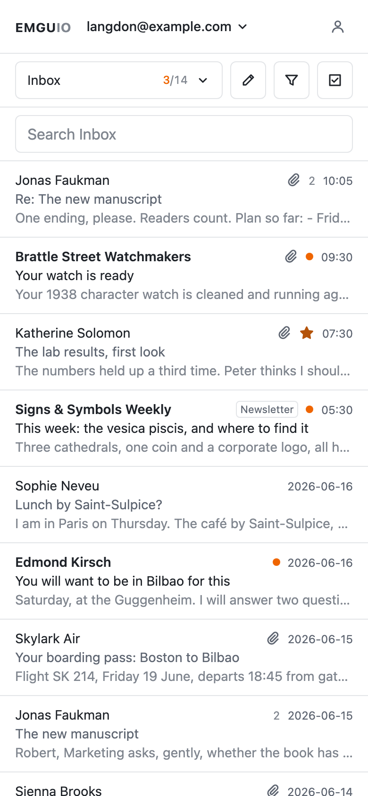

# emguio

A self-hosted webmail client. Each user adds the mail servers they read from — an incoming
IMAP server and, optionally, an outgoing SMTP one — and reads their mail in the browser.

- **Self-hosted.** One static binary, one SQLite file, one port.
- **Invitation only.** A user exists because somebody with a shell on the host printed a link.
- **Email configs belong to the user.** Added in Settings rather than in a config file, and never
  mixed: one is shown at a time.

## What it does

**Reading**

- Folders with their unread counts, and lists newest first by the date mail arrived.
- Messages open with their attachments listed. HTML is shown in a sandbox, and remote images load
  through a proxy that hides the reader; in Junk they wait until asked for.
- A folder is searched on the mail server, and Unread only narrows any list.
- A message shows the conversation it is in, where the server threads, with the replies from Sent.
- Newsletters are tagged. Unsubscribe stops one in a click where its sender allows that, and
  otherwise opens their page.

**Keeping it tidy**

- Read, star, archive, delete, spam and move, for one message or a selection, done on the mail
  server. Gmail's keys work.
- Trash and Junk empty in one go.
- Folders of one's own are made, renamed, moved, deleted when empty, and dragged into order. The
  server's own stay as they are.

**Writing**

- New, reply, reply all and forward, sent through the account's outgoing server and kept in Drafts
  while being written.
- Send later, where the outgoing server can hold mail (FUTURERELEASE), as mailio can. Where the
  server shows held mail in a Scheduled folder, it can be changed or cancelled until it goes.

**Accounts**

- Any number of mail accounts, added in Settings, where the address is often enough to find the
  servers. They are listed in the order the user puts them.
- The header shows which accounts have unread mail, and the tab's icon gets a dot.

**Web app and notifications**

- Runs as a web app: installed from the browser on a phone or a computer, it opens in its own
  window like any other app.
- Sends notifications of new mail to the devices a user chooses. Each account sends them right
  away or as a digest, every 30 minutes to 4 hours, from the folders ticked.

**Small**

- Only each folder's newest headers are kept, Inbox's 30 and every other's 10, so a folder opens at
  once. Everything else is read from the mail server when asked for. Message bodies and attachments
  are not stored, except a draft's while it is being written.
- Dates are ISO, like 2026-11-13, and times are on a 24-hour clock.

## Install

### 1. Compose it

Behind [caddy-docker-proxy](https://github.com/lucaslorentz/caddy-docker-proxy), which gives it a
certificate from its labels and reaches it over the external `caddy` network:

```yaml
# compose.yml
services:
  emguio:
    image: ghcr.io/reeywhaar/emguio:latest
    restart: unless-stopped
    environment:
      EMGUIO_PUBLIC_URL: https://mail.example.com
      EMGUIO_SECRET_KEY: ${EMGUIO_SECRET_KEY}
    volumes:
      - emguio-data:/data
    networks:
      - caddy
    labels:
      caddy: mail.example.com
      caddy.reverse_proxy: "{{upstreams 80}}"

volumes:
  emguio-data:

networks:
  caddy:
    external: true
```

The key seals the mail passwords users save. Make it once and keep it, apart from the data
volume and its backups: a new one makes every user enter their passwords again.

```sh
echo "EMGUIO_SECRET_KEY=$(openssl rand -base64 32)" > .env
```

### 2. Start it

```sh
docker compose up -d
docker compose logs emguio
```

With nobody signed up yet, it logs an invitation for the first user:

```
emguio-1  | {"time":"…","level":"INFO","msg":"no users yet: open this link to make the first one","link":"https://mail.example.com/invite/r8Kp…","expires_at":"…"}
```

### 3. Make your user

Open the link, and choose a username and a password.

[](docs/screenshots/invite.png)

### 4. Add a mail account

In **Settings → Add mail account**, the address is often enough: the servers are filled in from
what the provider publishes, then the password, and **Test connection** signs in to both before
anything is saved.

[](docs/screenshots/account.png)

### 5. Read your mail

[](docs/screenshots/mail.png)

On a phone:

<a href="docs/screenshots/phone.png"></a>

Invented mail, captured from the real thing by `npm --prefix web run screenshots`; see
[docs/screenshots](docs/screenshots/).

More users with `docker compose exec emguio emguio invite`.

## More

- [docs/deploy.md](docs/deploy.md): the environment, the image, and running from a checkout.
- [docs/api.md](docs/api.md): the HTTP API, also served at `/docs` on any instance.
- [docs/email-configs.md](docs/email-configs.md): mail accounts, their servers and passwords.
- [docs/reading.md](docs/reading.md): how mail is read.
- [docs/sending.md](docs/sending.md): how mail is written and sent.
- [docs/push.md](docs/push.md): the app and its notifications.
- [docs/conventions.md](docs/conventions.md): how the code is written.
